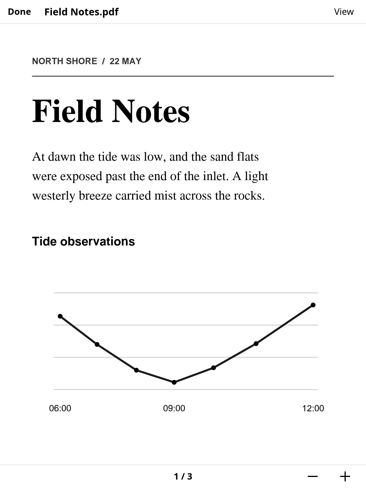

<div align="center">


# Viewer

**Open PDFs, JPEGs, and PNGs on your Kindle.**

[Install guide](INSTALL.md) · [Changelog](CHANGELOG.md)

</div>

Viewer is a standalone PrimitiveOS app for reading PDFs and looking at images offline. Open a file from your
Kindle’s storage or choose **Open in Viewer** from Files. Viewer keeps a small Recent list and saves your place
in a PDF.

## Screenshots

| Read a PDF | View an image | Open a file |
|---|---|---|
|  |  |  |

<sub>Desktop simulation at the Kindle Oasis 3 resolution.</sub>

[Preview continuous scrolling across two PDF pages](docs/images/viewer-scroll.png)

## Using Viewer

- Tap **Open** to browse files or choose a document under **Recent**.
- Scroll continuously through a PDF with vertical swipes or the Kindle page buttons. The page indicator shows where you are.
- Tap **−** or **+** to change the zoom. Open **View** to fit the page or image to the screen or width, or to rotate it.
- Files 0.1.1 or later can open a supported document in Viewer. Closing Viewer returns to Launcher.

## Build and preview

Keep `doannt-kindle-tools` and `doannt-kindle-launcher` beside this checkout. For the desktop preview, place a multipage
PDF, a JPEG, and a PNG in the sample Documents folder. The preview writes PNG screenshots to the output folder.

```sh
cargo test --workspace --locked
cargo run --locked -p viewer-kindle --features desktop-preview --bin viewer-desktop -- \
  /path/to/sample-storage build/previews Documents/sample.pdf Documents/photo.jpg Documents/image.png
cargo zigbuild --locked --release -p viewer-kindle --target armv7-unknown-linux-musleabihf
sh scripts/stage.sh armhf
```

## Licence

Copyright (C) 2026 Doan Nguyen.

Viewer’s code uses the PolyForm Noncommercial License 1.0.0. Original documentation, screenshots, and artwork use
CC BY-NC-SA 4.0. [Code licence](LICENSE) · [Documentation and artwork licence](LICENSE-DOCS)

Bundled open-source libraries and PDF resources retain their own terms. [Third-party notices](docs/licenses/README.md)
