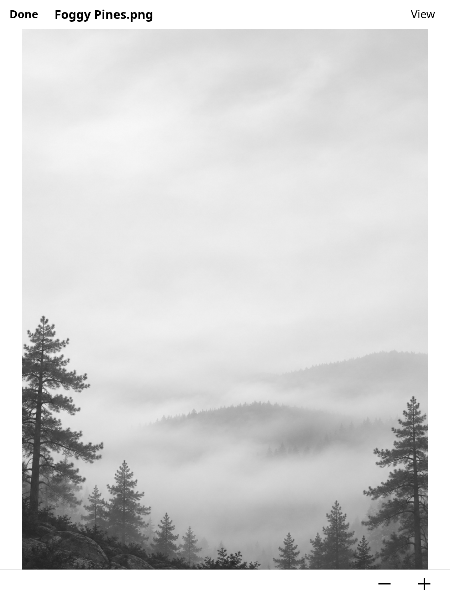
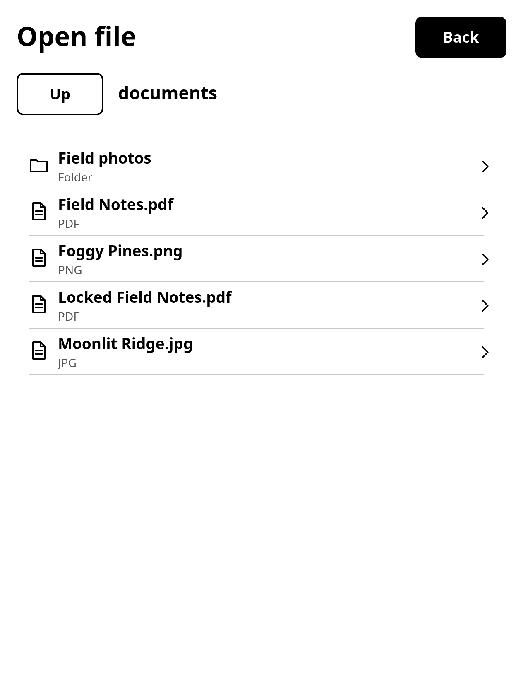

# Viewer

**Open PDFs, JPEGs, and PNGs**

  

[**Download**](https://github.com/PrimitiveOS/kindle-primitive-viewer/releases/latest) · [**Install guide**](INSTALL.md) · [**Changelog**](CHANGELOG.md)

---

Open PDFs, JPEGs, and PNGs stored on your Kindle. Use vertical swipes or the Kindle page buttons to scroll through the file picker and read PDFs continuously. The page indicator shows where you are. Use the zoom controls to adjust the view, and open View to fit or rotate PDFs and images.

Open Viewer from Launcher or choose Open in Viewer from Files 0.1.1 or later. Viewer reads documents offline and saves your place on the Kindle.

## Quick start

After setting up PrimitiveOS, open **Store** from Primitive Launcher. Choose **Viewer** under **Apps**,
tap **Get**, and open it from the Launcher grid. The [install guide](INSTALL.md) also covers the standalone USB package.

## Screenshots

| Read a PDF | View an image | Open a file |
|---|---|---|
|  |  |  |

Desktop simulation at the Kindle Oasis 3 resolution.

[Preview continuous scrolling across two PDF pages](docs/images/viewer-scroll.png)

## Highlights

- Open PDFs, JPEGs, and PNGs stored on your Kindle.
- Use vertical swipes or the Kindle page buttons to scroll through the file picker and read PDFs continuously.
- The page indicator shows where you are.

## Status

| Device | Status |
|---|---|
| Kindle Oasis 3 (1264 × 1680, firmware 5.18.2) | Tested on hardware |

**Current version: 0.1.2.** Changes are in [CHANGELOG.md](CHANGELOG.md).

## Downloads

The badge at the top shows the number of Store downloads. It counts GitHub downloads of this app's release packages, across all versions and architectures, and is refreshed daily from the [Store catalog](https://primitiveos.github.io/kindle-primitive-catalog/v1/index.json).

## Documentation

[Install guide](INSTALL.md) · [Changelog](CHANGELOG.md)

## Licence

Copyright (C) 2026 Doan Nguyen.

Viewer’s code uses the PolyForm Noncommercial License 1.0.0. Original documentation, screenshots, and artwork use
CC BY-NC-SA 4.0. [Code licence](LICENSE) · [Documentation and artwork licence](LICENSE-DOCS)

Bundled open-source libraries and PDF resources retain their own terms. [Third-party notices](docs/licenses/README.md)
